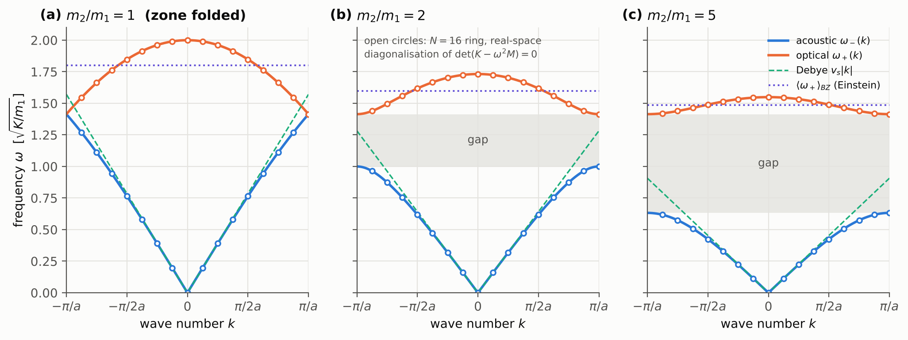
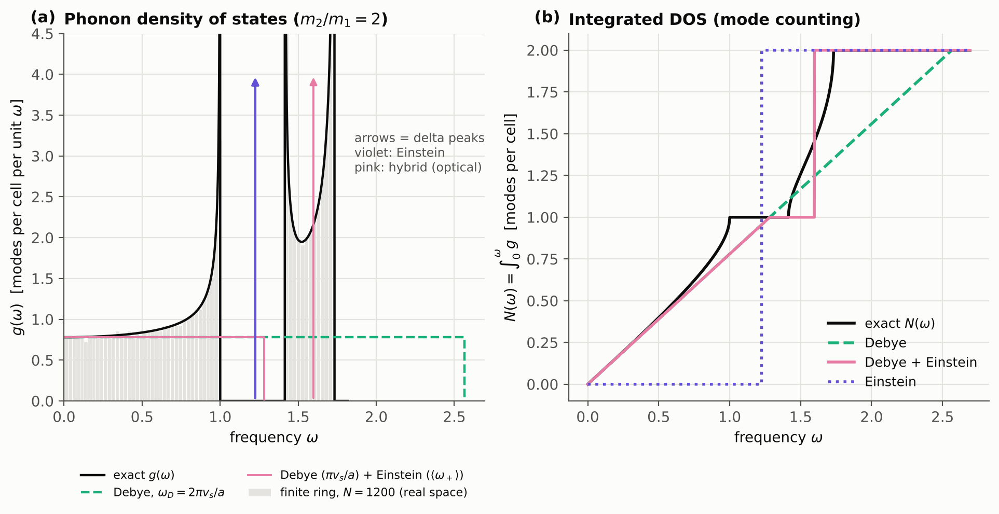
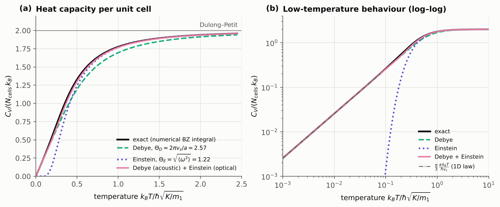
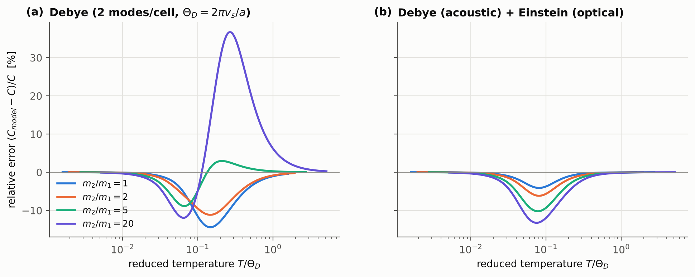
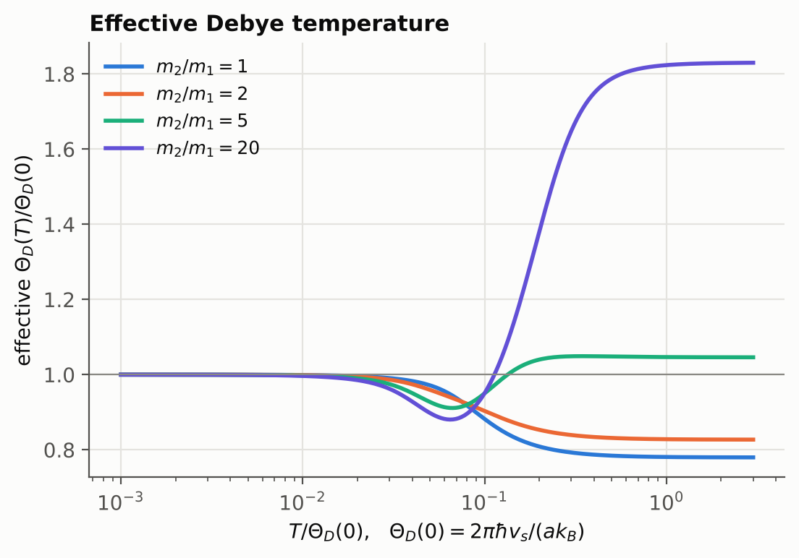
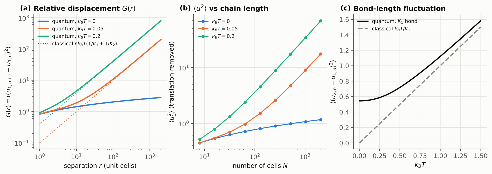
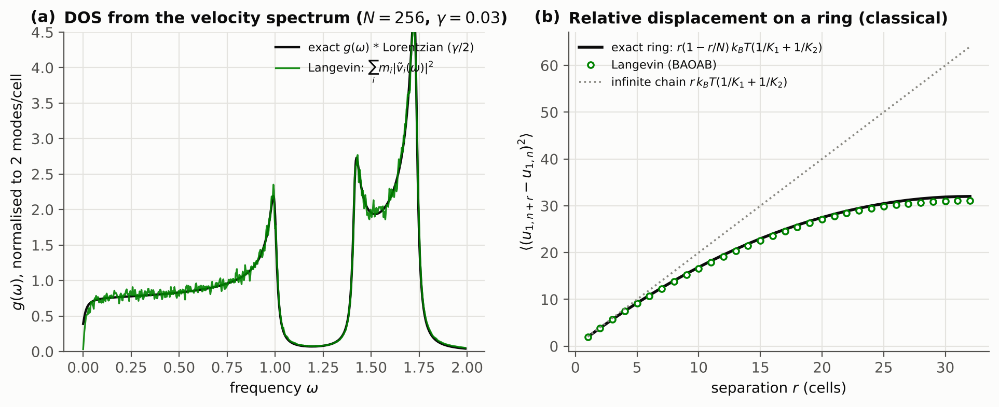

# Diatomic Chain Phonons in Python: Acoustic & Optical Branches, Phonon Density of States and Heat Capacity vs. Debye and Einstein Models

[](https://www.python.org/)
[](LICENSE)
[](tests/test_physics.py)
[](https://colab.research.google.com/github/jesus-garcia-izquierdo/diatomic-chain/blob/main/notebooks/diatomic_chain_quickstart.ipynb)
<br>
[](https://github.com/topics/condensed-matter-physics)
[](https://github.com/topics/phonons)
[](https://github.com/topics/lattice-dynamics)
[](https://github.com/topics/statistical-mechanics)
[](https://github.com/topics/density-of-states)
[](https://github.com/topics/physics-simulation)

**Autor:** [Jesús García Izquierdo](https://github.com/jesus-garcia-izquierdo) | Físico e Investigador (M.Sc. student in Condensed Matter Physics).

Simulación en Python de la dinámica de red y la termodinámica de fonones de la **cadena diatómica unidimensional**: ramas acústica y óptica, densidad de estados (DOS) de fonones en forma cerrada, calor específico numérico comparado con los modelos de **Debye** y **Einstein**, fluctuaciones de los desplazamientos atómicos y validación independiente mediante **dinámica de Langevin**. Unidades reducidas $\hbar = k_B = 1$.

---

## El Problema Físico

Un sólido cristalino tiene del orden de $10^{23}$ grados de libertad acoplados. En la **aproximación armónica** el potencial se desarrolla a segundo orden alrededor de la configuración de equilibrio, el problema de pequeñas oscilaciones se reduce a $\det(\Phi-\omega^2M)=0$ y, en coordenadas normales, el cristal se convierte en un **sistema ideal** de osciladores desacoplados. La **simetría de traslación discreta** del cristal (teorema de Bloch) reduce además ese problema a una matriz pequeña $D(k)$ para cada número de ondas $k$ de la primera zona de Brillouin. En la **colectividad canónica** toda la termodinámica depende solo de la densidad de estados $g(\omega)$:

$$
\frac{X(T)}{N}=\int_0^\infty g(\omega)\,x(\omega,T)\,d\omega ,\qquad
c(\omega,T)=k_B\frac{(\hbar\omega/2k_BT)^2}{\sinh^2(\hbar\omega/2k_BT)} .
$$

La **cadena diatómica** es el cristal mínimo que contiene todos los ingredientes de uno real: una rama acústica (sonido), una rama óptica (los dos átomos de la base oscilando en contrafase), un gap de frecuencias, singularidades de van Hove en la DOS y un calor específico que no es ni el de Debye ni el de Einstein.

```
    K2        K1        K2        K1        K2
~~~~~~~ (m1) ~~~~~~~ (m2) ~~~~~~~ (m1) ~~~~~~~ (m2) ~~~~~~~
         u(1,n)       u(2,n)      u(1,n+1)     u(2,n+1)
        |<------------ a ------------>|
```

Hamiltoniano (primeros vecinos, anillo de Born–von Kármán de $N$ celdas):

$$
H=\sum_n\Big[\frac{p_{1,n}^2}{2m_1}+\frac{p_{2,n}^2}{2m_2}+\frac{K_1}{2}(u_{2,n}-u_{1,n})^2+\frac{K_2}{2}(u_{1,n+1}-u_{2,n})^2\Big]
$$

Con el ansatz de Bloch $u_{s,n}=e_s\,e^{i(kna-\omega t)}/\sqrt{m_s}$, $\sigma=K_1+K_2$ y $\mu=m_1m_2/(m_1+m_2)$:

$$
D(k)=\begin{pmatrix}\sigma/m_1 & -(K_1+K_2e^{-ika})/\sqrt{m_1m_2}\\ -(K_1+K_2e^{ika})/\sqrt{m_1m_2} & \sigma/m_2\end{pmatrix},
\qquad
\omega_\pm^2=\frac{\sigma}{2\mu}\Big[1\pm\sqrt{1-\tfrac{16K_1K_2\mu^2}{\sigma^2m_1m_2}\sin^2\tfrac{ka}{2}}\Big]
$$

DOS por celda en forma cerrada (normalizada a 2 modos), con $s=\sin^2(ka/2)$:

$$
s(\omega)=\frac{m_1m_2\,\omega^2(\sigma/\mu-\omega^2)}{4K_1K_2},\qquad
g(\omega)=\frac{1}{\pi}\frac{|s'(\omega)|}{\sqrt{s(1-s)}}\quad (0<s<1)
$$

| Magnitud | Expresión |
|---|---|
| Velocidad del sonido | $v_s=a\sqrt{K_1K_2/[(K_1+K_2)(m_1+m_2)]}$ |
| Techo de la banda óptica | $\omega_+(0)=\sqrt{\sigma/\mu}$ |
| Bordes del gap ($K_1=K_2=K$) | $\sqrt{2K/m_{\max}}$, $\sqrt{2K/m_{\min}}$ |
| Segundo momento de la DOS | $\langle\omega^2\rangle=\sigma/(2\mu)$ (exacto, de $\mathrm{Tr}\,D$) |
| $C_V$ a baja $T$ (ley 1D) | $C_V/Nk_B=\frac{\pi}{3}\,a k_BT/(\hbar v_s)$ |
| $C_V$ a alta $T$ | $C_V/Nk_B=2\,[1-\hbar^2\langle\omega^2\rangle/12(k_BT)^2]$ |
| Corte de Debye (2 modos/celda) | $\omega_D=2\pi v_s/a$ |
| $\Theta_D(T\to\infty)$ | $\sqrt{3\langle\omega^2\rangle}$ |
| Desplazamiento relativo clásico | $G(r)=r\,k_BT\,(1/K_1+1/K_2)$ |

**Qué resuelve el código:**

* la dinámica de red **dos veces de forma independiente** (teorema de Bloch y diagonalización directa $2N\times2N$ en el espacio real), que coinciden a $10^{-8}$;
* la DOS $g(\omega)$ y el número acumulado de modos $N(\omega)$ en **forma cerrada** para la cadena general $(m_1,m_2,K_1,K_2)$, contrastados con muestreo en $k$ e histogramas de cadenas finitas;
* $U$, $C_V$, $F$ y $S$ por celda (fonones cuánticos y límite clásico) por cuadratura de Gauss–Legendre en la zona de Brillouin;
* la comparación cuantitativa con los modelos de **Debye**, **Einstein** e **híbrido Debye + Einstein**, la temperatura de Debye efectiva $\Theta_D(T)$ y su dependencia con el cociente de masas;
* otros observables: desplazamiento relativo $G(r)$ (ausencia de orden de largo alcance en 1D), $\langle u^2\rangle$ frente a $N$, fluctuaciones de enlace;
* una **simulación de Langevin** (integrador BAOAB) que reproduce la DOS (espectro de velocidades), Dulong–Petit (fluctuaciones de energía) y las correlaciones de desplazamiento.

---

## Modelos y Resultados

### Scripts y módulos

| Script / módulo | Concepto físico | Resultado |
|---|---|---|
| `diatomic_chain/parameters.py` | Parámetros del cristal $(m_1,m_2,K_1,K_2,a)$ | `ChainParameters` inmutable; $v_s$, gap, $\langle\omega^2\rangle$ |
| `diatomic_chain/dispersion.py` | Matriz dinámica $D(k)$, teorema de Bloch | Ramas $\omega_\pm(k)$, vectores propios, $v_g$, malla BvK |
| `diatomic_chain/real_space.py` | Pequeñas oscilaciones $\det(K-\omega^2M)=0$ | Espectro de anillos y cadenas abiertas sin Bloch |
| `diatomic_chain/dos.py` | Densidad de estados de fonones | $g(\omega)$ y $N(\omega)$ cerradas; histogramas; DOS ensanchada |
| `diatomic_chain/thermodynamics.py` | Colectividad canónica, gas de fonones ideal | $U, C_V, F, S$; descomposición por ramas; asintóticas |
| `diatomic_chain/models.py` | Modelos de Debye (1D), Einstein e híbrido | Curvas modelo, ajustes, $\Theta_D(T)$ efectiva |
| `diatomic_chain/observables.py` | Fluctuaciones térmicas y de punto cero | $G(r)$, $\langle u^2\rangle(N)$, fluctuación de enlace |
| `diatomic_chain/langevin.py` | Ecuación de Langevin, relación fluctuación–respuesta | DOS por espectro de velocidades, $C_V$ por $\mathrm{Var}(E)/k_BT^2$ |
| `scripts/make_figures.py` | Todo lo anterior | 11 figuras en `figures/` + `results/results.json` |
| `notebooks/diatomic_chain_quickstart.ipynb` | Ramas, DOS y $C_V$ | Demostración ejecutable en Google Colab |
| `tests/test_physics.py` | Comparación con resultados exactos independientes | 26 tests |

<!-- ESPACIO PARA GIF/IMAGEN: inserta aquí una previsualización (p. ej. un GIF de los modos normales o figures/dispersion.png + figures/heat_capacity.png) -->



### Resultados principales

Cadena de referencia $m_1=1$, $m_2=2$, $K_1=K_2=1$, $a=1$. Todos los números los genera `scripts/make_figures.py` y se guardan en `results/results.json`.

| $k_BT$ | exacto | Debye | Einstein | Debye + Einstein |
|---:|---:|---:|---:|---:|
| 0.01 | 0.02566 | 0.02565 | 2×10⁻⁴⁹ | 0.02565 |
| 0.1 | 0.2629 | 0.2565 | 0.00144 | 0.2565 |
| 0.3 | 0.8553 | 0.7654 | 0.5816 | 0.8141 |
| 0.5 | 1.3286 | 1.1931 | 1.2411 | 1.3023 |
| 1.0 | 1.7764 | 1.6952 | 1.7677 | 1.7684 |
| 2.0 | 1.9393 | 1.9129 | 1.9387 | 1.9372 |

$C_V/(Nk_B)$ por celda. Los parámetros de los modelos los fija la física, no un ajuste: $\Theta_D=2\pi v_s/a=2.565$, $\Theta_E=\sqrt{\langle\omega^2\rangle}=1.225$.

| Resultado | Valor |
|---|---|
| Pendiente $C_V/T$ a baja $T$ (numérica vs. $\pi a/3v_s$) | 2.56510 vs. 2.56510 |
| Error máximo de Debye ($m_2/m_1 = 1, 2, 5, 20$) | 14 %, 11 %, 9 %, 37 % |
| Error máximo del híbrido Debye + Einstein | 4 %, 6 %, 10 %, 13 % |
| $\Theta_D(\infty)/\Theta_D(0)$ ($m_2/m_1 = 1, 2, 5, 20$) | 0.78, 0.83, 1.05, 1.83 |
| Pendiente de $G(r)$ en $\ln r$ a $T=0$ (numérica vs. $\hbar a/\pi M v_s$) | 0.259899 vs. 0.259899 |
| Langevin, $C_V/N$ por fluctuaciones ($N=64$) | 1.956 ± 0.023 (exacto 1.9922) |
| Espacio real vs. Bloch (diferencia máxima) | $2\times10^{-8}$ |

* **Debye** es exacto a baja $T$ (solo importa $v_s$) pero falla en la región intermedia, donde se lee la DOS real; con contraste de masas grande el error llega al 37 %.
* **Einstein** con $\omega_E^2=\langle\omega^2\rangle$ es exacto en la corrección $1/T^2$ a alta $T$, pero cae exponencialmente a baja $T$.
* **Debye (acústica) + Einstein (óptica)** reduce el error al 6 % para $m_2/m_1=2$; su error residual (~14 % con contraste grande) es el de Debye sobre una rama acústica sinusoidal.
* **No hay orden de largo alcance en 1D**: $G(r)\propto r$ a $T>0$ y $\propto\ln r$ a $T=0$ (argumento de Landau–Peierls).

| | |
|---|---|
|  |  |
|  |  |
|  |  |

### Lógica del programa

```
ChainParameters(m1, m2, K1, K2, a)                 dataclass inmutable (validada, hashable)
        │
        ├──► dispersion ──► ω±(k), e(k)  ─────────┬──► dos ──► g(ω), N(ω), histogramas
        │                                          │
        ├──► real_space ──► det(K − ω²M) = 0 ──────┘   (comprobación independiente)
        │
        ├──► thermodynamics ──► Σ_modos x(ω,T) por cuadratura en k ──► U, C_V, F, S
        │                                  │
        │                                  └──► models ──► Debye / Einstein / híbrido, ajustes, Θ_D(T)
        │
        ├──► observables ──► ⟨|Q|²⟩ · |proyección|² ──► G(r), ⟨u²⟩(N), enlaces
        │
        └──► langevin ──► trayectoria BAOAB ──► espectro, Var(E)/T², G(r) en el anillo
                                                         │
scripts/make_figures.py ◄────────────────────────────────┘  figures/*.png + results/results.json
```

### Tipos de datos

| Objeto | Tipo | Por qué |
|---|---|---|
| Parámetros físicos | `ChainParameters` (`@dataclass(frozen=True)`) | no pueden cambiar a mitad de un cálculo; las magnitudes derivadas son `@property` y nunca quedan desactualizadas |
| Números de onda, frecuencias, temperaturas | `numpy.ndarray[float64]` | cálculo vectorizado, sin bucles de Python sobre $k$ |
| Ramas | array de forma `k.shape + (2,)` (índice 0 acústica, 1 óptica) | misma convención que `numpy.linalg.eigh` |
| $D(k)$, vectores de polarización | `numpy.ndarray[complex128]`, forma `(..., 2, 2)` | la fase de Bloch $e^{ika}$ los hace complejos |
| Modos de una cadena finita | dataclass `FiniteChainModes` | frecuencias, vectores y condición de contorno viajan juntos |
| Histograma de la DOS | dataclass `DOSHistogram` | bordes, centros y valores no pueden desincronizarse |
| Curvas termodinámicas | dataclass `ThermoResult` | $U, C, F, S$ del mismo cálculo siempre juntas |
| Ajustes | dataclass `FitResult` | campos con nombre (`theta`, `rms_error`) en lugar de una tupla anónima |
| Velocidades de Langevin | `numpy.ndarray[float32]` | el array más grande (muestras × átomos): mitad de memoria, precisión de sobra para un espectro |
| Números aleatorios | `numpy.random.Generator` (PCG64, semilla fija) | trayectorias reproducibles bit a bit |

### Métodos numéricos

| Tarea | Método | Motivo |
|---|---|---|
| Ramas $\omega_\pm(k)$ | forma cerrada; $\omega_-^2=\det D/\omega_+^2$ (Vieta) | evita la cancelación catastrófica para $ka\lesssim10^{-8}$ |
| Vectores de polarización | `numpy.linalg.eigh` vectorizado sobre arrays $(n,2,2)$ | las ramas no se cruzan → problema bien condicionado |
| Cadena finita | `scipy.linalg.eigh(K, M)` (problema generalizado simétrico) | comprobación independiente sin teorema de Bloch |
| DOS | forma cerrada; $s(\omega)$ desarrollada; promedios exactos por intervalo $\Delta N/\Delta\omega$ | sin integrales singulares; referencia exacta para histogramas |
| Termodinámica | Gauss–Legendre en $k$ sobre $[0,\pi/a]$, partido en $k_c=40k_BT/\hbar v_s$ | integrando suave (sin van Hove), convergencia exponencial, resuelve baja $T$ |
| Funciones de un oscilador | fórmulas con `expm1` | sin desbordamiento para $\hbar\omega\gg k_BT$ ni pérdida de precisión para $\hbar\omega\ll k_BT$ |
| $G(r)$ | Gauss–Legendre compuesta (paneles de 48 nodos, nº de paneles $\propto r$) | resuelve $e^{ikra}$ con coste lineal |
| Función de Debye $\mathcal D_1$ | Gauss–Legendre de 200 nodos, integrando cortado en $y=60$ | precisión uniforme para cualquier $x_D$ |
| $\Theta_D(T)$ | método de Brent en $\ln x_D$ | inversión robusta |
| Langevin | desdoblamiento BAOAB; Verlet con velocidades si $\gamma=0$; periodograma de Welch | muestreo configuracional preciso; límite NEV simpléctico |

---

## Quick Start

**Requisitos:** Python ≥ 3.10, `numpy`, `scipy`, `matplotlib` (opcional: `pytest`, `xelatex` para recompilar los PDF).

```bash
git clone https://github.com/jesus-garcia-izquierdo/diatomic-chain.git
cd diatomic-chain
pip install -r requirements.txt
python tests/run_tests.py               # 26 tests físicos (o: pytest)
python scripts/make_figures.py          # todas las figuras + results/results.json (~1 min)
python scripts/make_figures.py --quick  # simulaciones de Langevin más cortas
```

Ejemplo mínimo:

```python
import numpy as np
from diatomic_chain import ChainParameters
from diatomic_chain import dispersion, dos, thermodynamics, models

p = ChainParameters(m1=1.0, m2=2.0, K1=1.0, K2=1.0, a=1.0)   # dataclass inmutable
print(p.describe())                                            # v_s, bordes de banda, gap, ...

k = np.linspace(-np.pi, np.pi, 501)
w = dispersion.omega(p, k)              # forma (501, 2): [acústica, óptica]

g = dos.analytic_dos(p, np.linspace(0, 2, 1000))   # DOS cerrada por celda

T = np.geomspace(1e-3, 5, 200)
C = thermodynamics.heat_capacity(p, T)             # C_V / (N k_B) cuántico
C_debye = models.debye_heat_capacity(T, models.debye_frequency(p))
C_einstein = models.einstein_heat_capacity(T, models.einstein_frequency_second_moment(p))
theta_D = models.effective_debye_temperature(T, C)  # Θ_D(T)
```

O directamente en el navegador: [](https://colab.research.google.com/github/jesus-garcia-izquierdo/diatomic-chain/blob/main/notebooks/diatomic_chain_quickstart.ipynb)

```
diatomic-chain/
├── diatomic_chain/        paquete Python (9 módulos documentados)
├── scripts/               make_figures.py
├── notebooks/             diatomic_chain_quickstart.ipynb (Colab)
├── tests/                 test_physics.py (26 tests) + run_tests.py (sin pytest)
├── figures/               figuras generadas
├── results/               results.json (todas las cifras citadas)
├── documents_spanish/     teoría en español (LaTeX + PDF)
├── documents_english/     teoría en inglés (LaTeX + PDF)
├── README.md · LICENSE · CITATION.cff · pyproject.toml · requirements.txt · .gitignore
```

---

## Documentación Teórica

La teoría completa (≈ 23 páginas por idioma, fuente LaTeX + PDF compilado), escrita de lo más general a lo más particular:

1. **Marco general**: los cinco elementos de un problema físico (objeto, campos, acoplamiento, escenario, observador) aplicados a un sólido; desarrollo armónico, pequeñas oscilaciones y coordenadas normales; simetría de traslación discreta y teorema de Bloch; cuantización (fonones); colectividad canónica, DOS, relación fluctuación–respuesta; modelos de Einstein, Debye e híbrido.
2. **La cadena diatómica**: dispersión, vectores propios y casos límite (plegado de zona, banda óptica plana, gap por contraste de rigidez); DOS cerrada; calor específico frente a los modelos; descomposición por ramas; dependencia con el cociente de masas; $\Theta_D(T)$ efectiva; otros observables ($U, F, S$, fluctuaciones de desplazamiento, Landau–Peierls); validación por Langevin; implementación numérica; discusión.

* 🇪🇸 Español: [`documents_spanish/cadena_diatomica_es.pdf`](documents_spanish/cadena_diatomica_es.pdf) · fuente [`cadena_diatomica_es.tex`](documents_spanish/cadena_diatomica_es.tex)
* 🇬🇧 English: [`documents_english/diatomic_chain_en.pdf`](documents_english/diatomic_chain_en.pdf) · source [`diatomic_chain_en.tex`](documents_english/diatomic_chain_en.tex)

Para recompilarlos: `xelatex` (dos pasadas) dentro de cada carpeta; las figuras se leen de `../figures/`.

**Referencias:** P. García González, *Termodinámica y Física Estadística II* (UAM); N. W. Ashcroft y N. D. Mermin, *Solid State Physics* (1976); C. Kittel, *Introduction to Solid State Physics* (2005); R. K. Pathria y P. D. Beale, *Statistical Mechanics* (2011); B. Leimkuhler y C. Matthews, *Appl. Math. Res. Express* **2013**, 34–56; R. Peierls, *Quantum Theory of Solids* (1955).

---

## Cómo citar

Si este código te resulta útil, cítalo así (también disponible en `CITATION.cff`):

```bibtex
@software{garcia_izquierdo_2026_diatomic_chain,
  author    = {García Izquierdo, Jesús},
  title     = {diatomic-chain: Lattice dynamics and phonon thermodynamics of the
               one-dimensional diatomic chain (acoustic and optical branches,
               phonon density of states, heat capacity vs. Debye and Einstein models)},
  year      = {2026},
  version   = {1.0.0},
  publisher = {GitHub},
  url       = {https://github.com/jesus-garcia-izquierdo/diatomic-chain},
  license   = {MIT}
}
```
